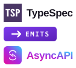

# Brand assets — pipeline lockup

The project's visual identity: the TypeSpec tile **emits** the AsyncAPI tile.

```
TypeSpec  →  [ → EMITS ]  →  AsyncAPI
```

Everything here is generated from a single geometry definition in
[`scripts/generate-brand-assets.ts`](../../scripts/generate-brand-assets.ts).
Do not hand-edit the SVGs or the two Astro components; edit the generator and
regenerate.

## Files

| File                                                | What it is                                             | Consumed by                                            |
| --------------------------------------------------- | ------------------------------------------------------ | ------------------------------------------------------ |
| `lockup-dark.svg`                                   | 126 × 112 full lockup, light ink, for dark backgrounds | `README.md` (`prefers-color-scheme: dark`)             |
| `lockup-light.svg`                                  | 126 × 112 full lockup, dark ink, for light backgrounds | `README.md` (fallback)                                 |
| `mark.svg`                                          | 72 × 36 compact mark, no captions, no text             | Starlight header, favicon work, OG source              |
| `../../website/public/brand-mark.png`               | 440 × 220 PNG of `mark.svg`                            | Open Graph cards (`astro-og-canvas` cannot decode SVG) |
| `../../website/src/assets/brand-mark.svg`           | Byte-identical copy of `mark.svg`                      | Starlight `logo` option (bundled, hashed)              |
| `../../website/src/components/Logo.astro`           | Compact mark as an Astro component                     | Site header, site footer                               |
| `../../website/src/components/PipelineLockup.astro` | Full lockup as an Astro component                      | Landing page hero                                      |

## Regenerate

```bash
pnpm run brand:generate   # rewrite all six artifacts + the OG PNG
pnpm run brand:check      # exit 1 if any text artifact drifted (wired into `verify`)
```

`brand:check` compares exact bytes, so it is deterministic across machines. The
PNG is regenerated by `brand:generate` only (PNG encoders are not guaranteed to
be byte-identical across platforms, so `verify` does not gate on it).

## Palette

| Token               | Hex                               | Used for                                         |
| ------------------- | --------------------------------- | ------------------------------------------------ |
| TypeSpec tile       | `#4A3665`                         | solid tile behind the white TSP glyph            |
| AsyncAPI gradient   | `#2DCCFD` → `#A829E2` → `#E50E99` | AsyncAPI tile, `AsyncAPI` caption, compact arrow |
| Emit block gradient | `#7C3AED` → `#5B21B6`             | the `→ EMITS` block                              |
| Ink (dark bg)       | `#EDEFF7`                         | `TypeSpec` caption in `lockup-dark`              |
| Ink (light bg)      | `#16131F`                         | `TypeSpec` caption in `lockup-light`             |

Two deliberate quirks:

- The compact badge's arrow uses `gradientUnits="userSpaceOnUse"`. A default
  (`objectBoundingBox`) gradient on a horizontal line has a zero-height bounding
  box and paints **nothing** — the shaft disappeared until this was fixed.
- The `AsyncAPI` wordmark keeps the official gradient on light backgrounds, so
  its cyan end is low-contrast on white. Logotypes are exempt from WCAG 1.4.3
  and 1.4.11; brand fidelity won. Do not "fix" this without a brand decision.

Both lockups use font-fallback stacks (`'Space Grotesk', 'Helvetica Neue', …`)
because an SVG loaded through `` cannot fetch web fonts. The Astro
components use `var(--font-*)` so the site's real webfonts apply.

## Embedding

GitHub renders `<picture>` with a `prefers-color-scheme` source, so the README
can be theme-aware. `assets/brand` is **not** in `package.json` `files`, so the
npm package does not ship it — the README must use absolute
`raw.githubusercontent.com` URLs, never relative paths:

```html
<p align="center">
  <picture>
    <source
      media="(prefers-color-scheme: dark)"
      srcset="
        https://raw.githubusercontent.com/LarsArtmann/typespec-asyncapi/master/assets/brand/lockup-dark.svg
      "
    />
    
  </picture>
</p>
```

On the npm package page the HTML sanitizer strips `<picture>`/`<source>` but
keeps the child ``, so npm falls back to the light lockup. That is the
intended result on npm's light background, but it has not been verified against
a live npm page since the markup changed — check it after the next publish.

## Provenance and trademark posture

The two tiles are **derivative uses of official marks**, not original artwork:

| Mark     | Source                                                                                                                                                                                                | Pinned commit                              | Blob date  |
| -------- | ----------------------------------------------------------------------------------------------------------------------------------------------------------------------------------------------------- | ------------------------------------------ | ---------- |
| AsyncAPI | [`asyncapi/brand` → `logos/asyncapi/mark/primary/SVG/asyncapi-logo-mark--primary.svg`](https://github.com/asyncapi/brand/blob/master/logos/asyncapi/mark/primary/SVG/asyncapi-logo-mark--primary.svg) | `fe0e60a486a978855a416a3e518dc30e87a47884` | 2022-09-06 |
| TypeSpec | [`microsoft/typespec` → `website/public/img/favicon.svg`](https://github.com/microsoft/typespec/blob/main/website/public/img/favicon.svg)                                                             | `74ed99a98e5f7fe506a5bed124ffc73cfecc8462` | 2024-10-25 |

Local snapshots of the downloaded originals live in
[`docs/logo-sources/`](../../docs/logo-sources). TypeSpec and AsyncAPI are
trademarks of their respective owners; this lockup describes an integration
between them and must not be read as an endorsement by either project. Using
these marks as the project's _primary_ identity is an open decision — see
[`docs/adr/`](../../docs/adr) for the recorded status.

The candidate concepts that produced this lockup are kept in
[`docs/logo-concepts.html`](../../docs/logo-concepts.html) (card 57 shipped,
marked `shipped`).
